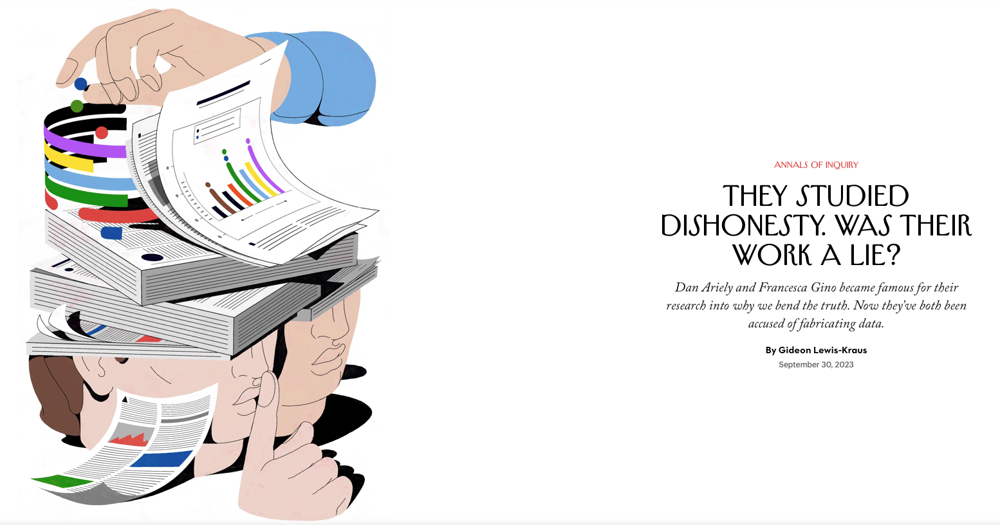
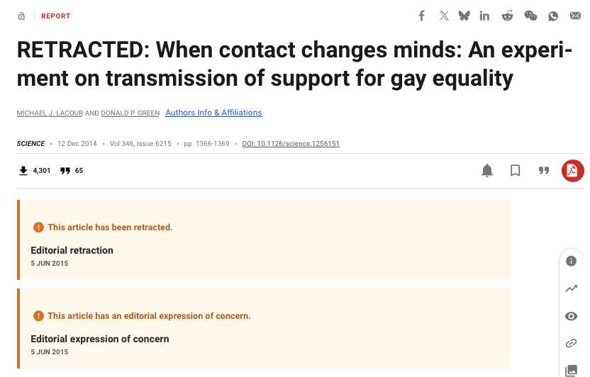
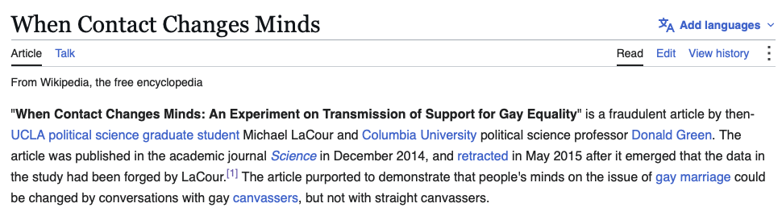
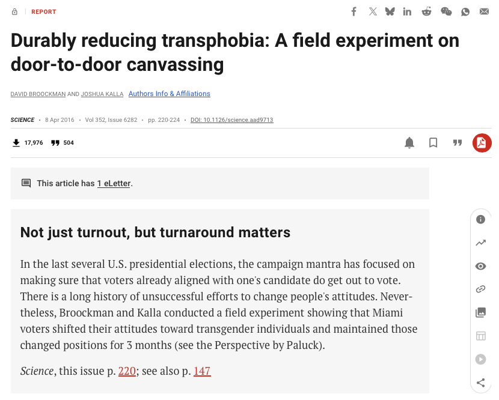
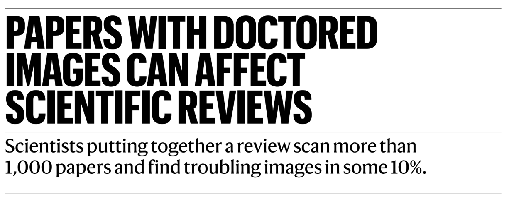
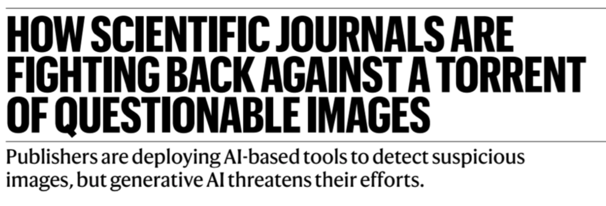
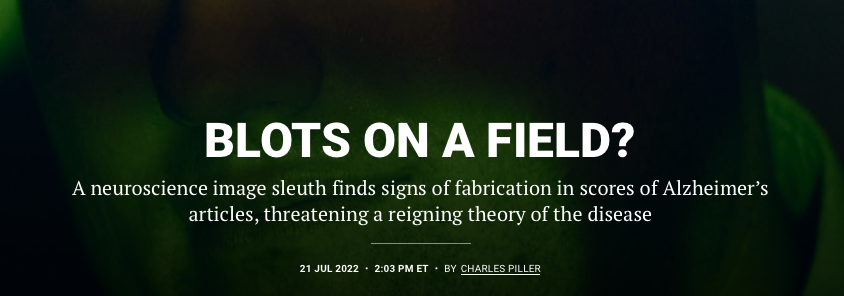
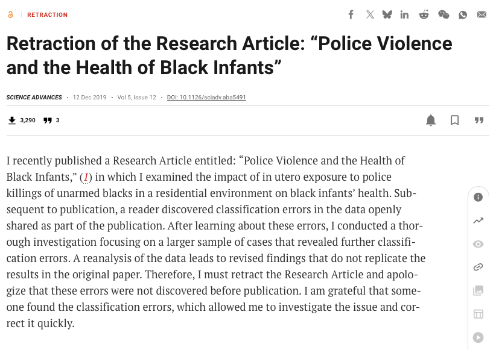
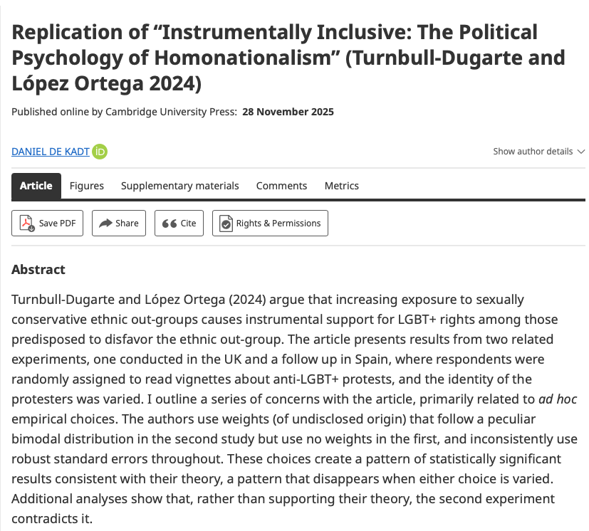
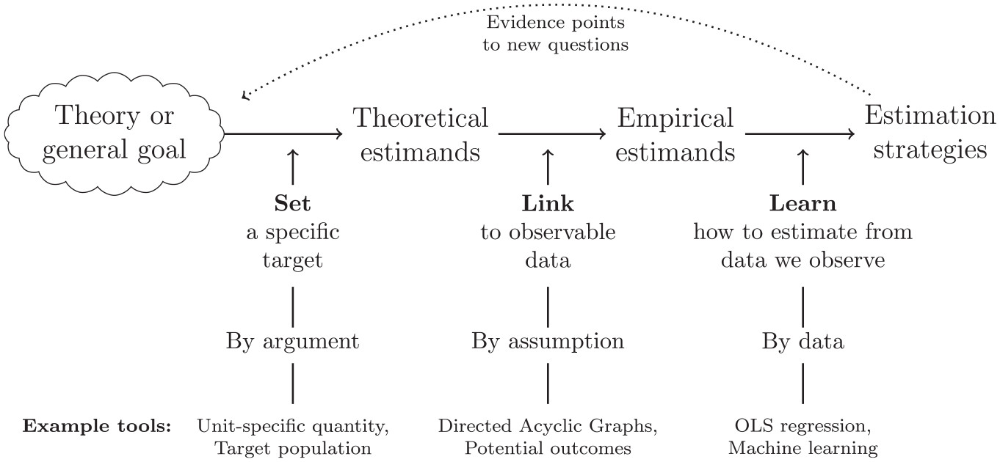

## `The problem`

 

:::{.r-stack}

{.fragment}

{.fragment .center width="750"}

{.fragment}

{.fragment}

{.fragment}

{.fragment}

{.fragment}

:::

. . .

Fraud is probably the fastest way to a press cover ... and even your own Wikipedia page!

. . .

Or, as my friend says, "you don't want to go from obscurity to disgrace"

## `But it's mostly not fraud`

 

:::{.r-stack}

{.fragment .center width="750"}

{.fragment}

:::

. . . 

Honest mistakes are possible, and so are theoretical and methodological disagreements 

## `A roadmap`

{fig-align="center" width=70%}

## `Course outline`

 

We aim to develop a research workflow that makes reproducibility feels natural and promotes conceptual clarity about the questions we ask, the route we take, and the answers we find

. . .

* [`Show how you do it`: Using Quarto and R]{.fragment .fade-in}

* [`Track while you do it`: Using Git and GitHub]{.fragment .fade-in}

* [`Say what you do`: Using (causal) diagrams]{.fragment .fade-in}

* [`Do what you say`: Using robust and flexible approaches]{.fragment .fade-in}
* [`Doubt what you do`: Using sensitivity analysis]{.fragment .fade-in}

* [`Did we even do it?` On the uses of AI-agents]{.fragment .fade-in}

## `Course assessment`

 

Assessment is conducted through a replication project consisting of three parts:

* **Part 1:** A written paper between 6,000 and 8,000 words and of a standard appropriate for submission to an academic journal 

* **Part 2:** This is complemented by a research diary (a log book)

* **Part 3:** Replication code written in any statistical software 

The submission deadline is noon on Monday of Week 5 of Hilary Term

## `Replication approach`

 

* [**Step 1**: Make a longlist of three articles that you wish to replicate.]{.fragment .fade-in}

* [**Step 2**: Pick one article to work with this term (other two are back-up)]{.fragment .fade-in}

* [**Step 3**: Get access to the data]{.fragment .fade-in}

* [**Step 4**: Replicate the descriptive statistics table]{.fragment .fade-in}

* [**Step 5**: Replicate the “main result” (i.e., the key argument / finding)]{.fragment .fade-in}

* [**Step 6**: Develop an extension (repeatability or robustness)]{.fragment .fade-in}

* [**Step 7**: Write a 6,000 – 8,000-word article (replication + extension)]{.fragment .fade-in}

* [**Step 8**: Keep a research diary]{.fragment .fade-in}

## `Resources`

 

* *Where to follow replication disputes?*:

  + [Retraction watch](https://retractionwatch.com)

  + [i4r](https://www.i4replication.org)

  + [Andrew Gelman's blog](https://statmodeling.stat.columbia.edu)
  
  + [Data Colada](https://datacolada.org)

* *Where to find data for replication?*:

  + Check your favorite author's website

  + Check your favorite journal's website

  + [OSF](https://osf.io)
  
  + [Harvard Dataverse](https://dataverse.harvard.edu)

