# OVB is everywhere! {background-color="#002147"}

\newcommand\indep{\perp\!\!\!\perp}
\newcommand\nindep{\not\!\perp\!\!\!\perp}

## OVB is everywhere! 

:::{.r-stack}

{.fragment}

{.fragment}

{.fragment}

{.fragment width="750"}

:::

# The anatomy of OVB {background-color="#002147"}

## A familiar example

Let's assume we want to estimate the causal effect of having a college degree ($X$) on income ($Y$), and we have observational data on these variables.

The unconditional association between $X$ and $Y$ is not the true causal effect, as it it *biased* (or [*confounded*]{.fragment .highlight-red}) by other variables $W$ such that:

  - They affect who gets a college degree ($W \rightarrow X$), and
  
  - They affect the income of individuals ($W \rightarrow Y$)
  
  
Common examples of such variables in the literature are family background and ability.

The omitted variable bias problem arises when we either [*do not know*]{.fragment .highlight-red} the appropriate $W$s, or knowing them, we have not [*measured*]{.fragment .highlight-red} them.

 

:::{.fragment .highlight-blue}

***When is omitting variables not problem?***

OVB is a *causal* concept. If you care about associations or predictions, then it is not an issue!

:::

## OVB structure {auto-animate=true}

::: {.columns}

::: {.column width="50%"}
***Regression***

::: {.left style="margin-top: 200px;"}
$$Y_i \color{white}{=  \alpha + {\beta} X_i + \gamma W_i + \epsilon_i}$$
:::

:::

::: {.column width="50%"}
***Path diagram***

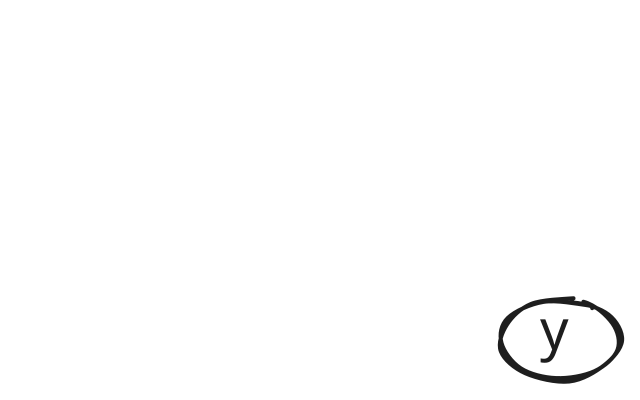

:::

:::

## OVB {auto-animate=true}

::: {.columns}

::: {.column width="50%"}
***Regression***

::: {style="margin-top: 200px;"}
$$Y_i =  \alpha \color{white}{+ {\beta} X_i + \gamma W_i + \epsilon_i}$$
:::

:::

::: {.column width="50%"}
***Path diagram***

:::

:::

## OVB {auto-animate=true}

::: {.columns}

::: {.column width="50%"}
***Regression***

::: {style="margin-top: 200px;"}
$$Y_i =  \alpha + \color{blue}{\beta} X_i \color{white}{+ \gamma W_i + \epsilon_i}$$
:::

:::

::: {.column width="50%"}
***Path diagram***

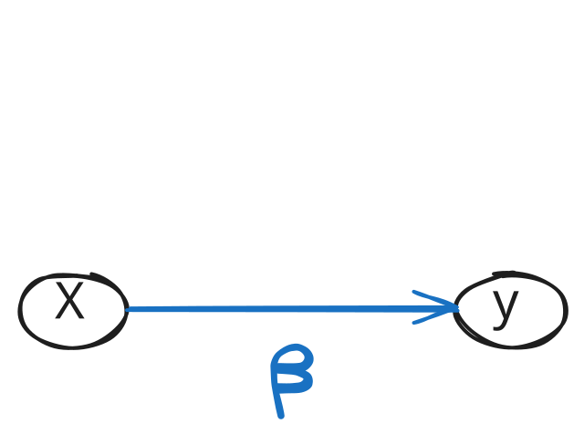
:::

:::

## OVB {auto-animate=true}

::: {.columns}

::: {.column width="50%"}
***Regression***

::: {style="margin-top: 200px;"}
$$Y_i =  \alpha + \beta X_i \color{white}{+ \gamma W_i + \epsilon_i}$$
:::

:::

::: {.column width="50%"}
***Path diagram***

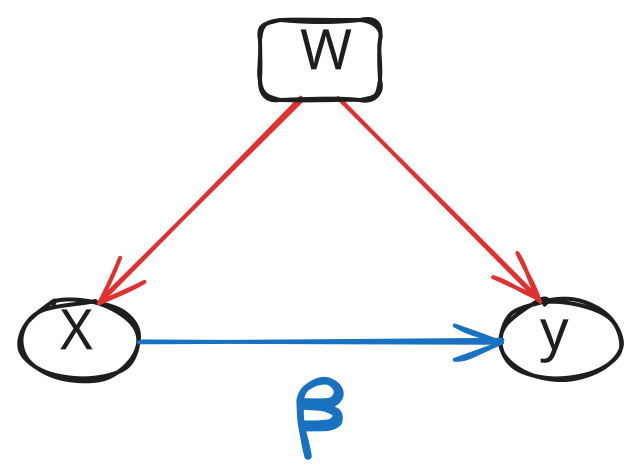
:::

:::

## OVB {auto-animate=true}

::: {.columns}

::: {.column width="50%"}
***Regression***

::: {style="margin-top: 200px;"}
$$Y_i =  \alpha + \beta X_i + \color{red}{\gamma} W_i \color{white}{+ \epsilon_i}$$
:::

:::

::: {.column width="50%"}
***Path diagram***

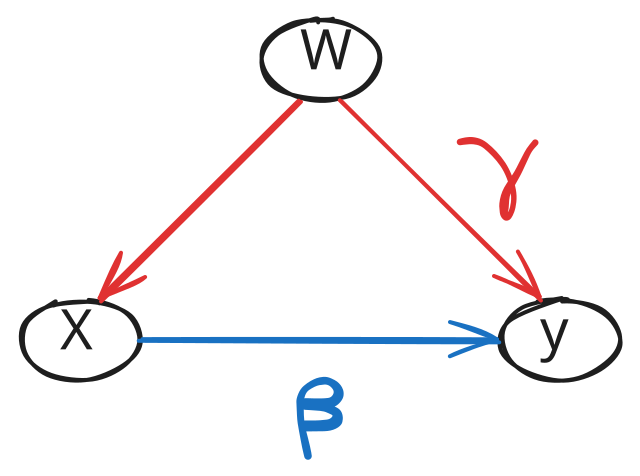
:::

:::

## OVB {auto-animate=true}

::: {.columns}

::: {.column width="50%"}
***Regression***

::: {style="margin-top: 200px;"}
$$Y_i =  \alpha + \beta X_i + \color{red}{\gamma} W_i \color{white}{+ \epsilon_i}$$
:::

:::

::: {.column width="50%"}
***Path diagram***

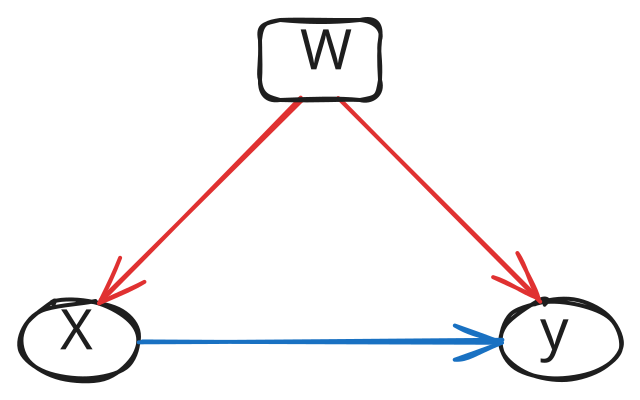
:::

:::

## OVB {auto-animate=true}

::: {.columns}

::: {.column width="50%"}
***Regression***

::: {style="margin-top: 200px;"}
$$Y_i =  \alpha + \beta X_i + \color{red}{\gamma} W_i \color{white}{+ \epsilon_i}$$
:::

:::

::: {.column width="50%"}
***Path diagram***

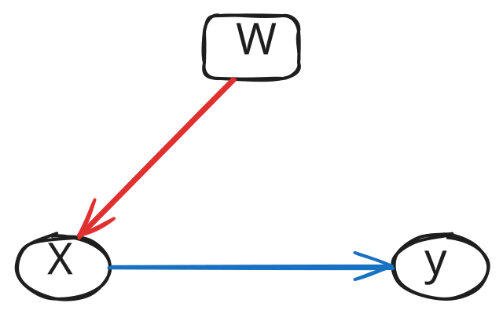
:::

:::

## OVB {auto-animate=true}

::: {.columns}

::: {.column width="50%"}
***Regression***

::: {style="margin-top: 200px;"}
$$Y_i =  \alpha + {\beta} X_i + \gamma W_i + \epsilon_i$$
:::

:::

::: {.column width="50%"}
***Path diagram***

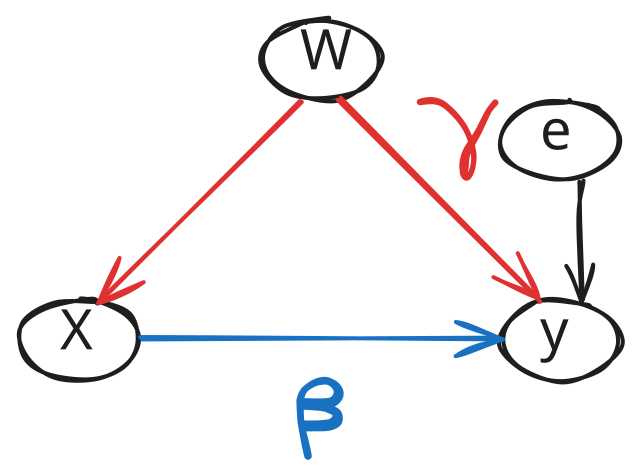

:::

:::

::: {.fragment}
$\text{corr}(X_i; \epsilon_i) = 0$
:::

:::{.fragment}
$X \rightarrow \dots \leftarrow \epsilon$ is $d-$separated
:::

## OVB {auto-animate=true}

::: {.columns}

::: {.column width="50%"}
***Regression***

::: {style="margin-top: 100px;"}
$$\color{grey}{Y_i =  \alpha + \beta X_i + \gamma W_i + \epsilon_i}$$

$$Y_i =  \zeta + \tilde{\beta} X_i + u_i$$
:::

:::

::: {.column width="50%"}
***Path diagram***

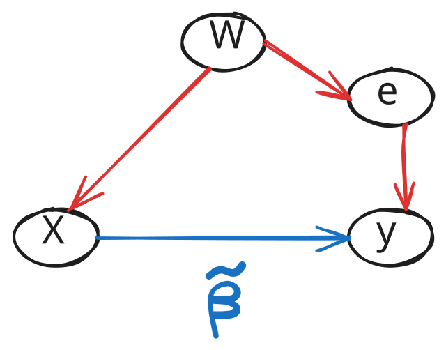
:::

:::

## OVB {auto-animate=true}

::: {.columns}

::: {.column width="50%"}
***Regression***

::: {style="margin-top: 100px;"}
$$\color{grey}{Y_i =  \alpha + \beta X_i +  \color{red}{\gamma W_i + \epsilon_i}}$$

$$Y_i =  \zeta + \tilde{\beta} X_i + \color{red}{u_i}$$

:::

:::

::: {.column width="50%"}
***Path diagram***

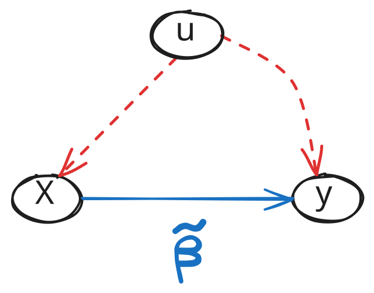
:::

:::

:::{.fragment}
$\text{corr}(X_i ; u_i) \neq 0$
:::

:::{.fragment}
$X \rightarrow u$ is $d-$connected
:::

## The OBV formula  {auto-animate=true}

::: {.columns}

::: {.column width="50%"}
***Regression***

::: {style="margin-top: 100px;"}
$$\color{grey}{Y_i =  \zeta + \color{red}{\tilde{\beta}} X_i + u_i}$$

$$
\color{red}{\tilde{\beta}} = \frac{\text{Cov}(X_i , Y_i)}{\text{Var}(X_i)}
$$

:::

:::

::: {.column width="50%"}
***Path diagram***

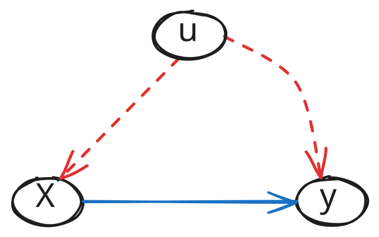
:::

:::

## The OBV formula  {auto-animate=true}

::: {.columns}

::: {.column width="50%"}
***Regression***

::: {style="margin-top: 100px;"}
$$\color{grey}{Y_i =  \zeta + \tilde{\beta} X_i + u_i}$$

$$
\tilde{\beta} = \frac{\text{Cov}(X_i , \color{green}{Y_i})}{\text{Var}(X_i)}
$$

$$
= \frac{\text{Cov}(X_i, \color{green}{\alpha + \beta X_i + \gamma W_i + \epsilon_i})}{\text{Var}(X_i)}
$$
:::

:::

::: {.column width="50%"}
***Path diagram***

:::

:::

## The OBV formula  {auto-animate=true}

::: {.columns}

::: {.column width="50%"}
***Regression***

::: {style="margin-top: 100px;"}
$$\color{grey}{Y_i =  \zeta + \tilde{\beta} X_i + u_i}$$

$$
\tilde{\beta} = \frac{\text{Cov}(X_i , Y_i)}{\text{Var}(X_i)}
$$

$$
= \frac{\color{green}{\text{Cov}(X_i}, \alpha + \color{blue}{\beta} X_i + \color{red}{\gamma} \color{green}{W_i} + \epsilon_i)}{\color{green}{\text{Var}(X_i)}}
$$

$$
= \color{blue}{\beta} + \underbrace{\color{red}{\gamma} \times \color{green}{\frac{\text{Cov}(X_i,W_i)}{\text{Var}(X_i)}}}_{\text{Bias}}
$$
:::

:::

::: {.column width="50%"}
***Path diagram***

:::

:::

## The OBV formula  {auto-animate=true}

::: {.columns}

::: {.column width="50%"}
***Regression***

::: {style="margin-top: 100px;"}
$$\color{grey}{Y_i =  \zeta + \color{red}{\tilde{\beta}} X_i + u_i}$$

$$
\tilde{\beta} = \frac{\text{Cov}(X_i , Y_i)}{\text{Var}(X_i)}
$$

$$
= \frac{\text{Cov}(X_i, \alpha + \beta X_i + \gamma W_i + \epsilon_i)}{\text{Var}(X_i)}
$$

$$
= \color{blue}{\beta} + \underbrace{\color{red}{\gamma}}_{\text{Impact}} \times \underbrace{\color{green}{\delta}}_{\text{Imbalance}}
$$
:::

:::

::: {.column width="50%"}
***Path diagram***

:::

:::

## The OBV formula  {auto-animate=true}

::: {.columns}

::: {.column width="50%"}
***Regression***

::: {style="margin-top: 100px;"}
$$\color{grey}{Y_i =  \zeta + \color{red}{\tilde{\beta}} X_i + u_i}$$

$$
\tilde{\beta} = \frac{\text{Cov}(X_i , Y_i)}{\text{Var}(X_i)}
$$

$$
= \frac{\text{Cov}(X_i, \alpha + \beta X_i + \gamma W_i + \epsilon_i)}{\text{Var}(X_i)}
$$

$$
= \color{blue}{\beta} + \underbrace{\color{red}{\gamma}}_{\text{Impact}} \times \underbrace{\color{green}{\delta}}_{\text{Imbalance}}
$$
:::

:::

::: {.column width="50%"}
***Path diagram***

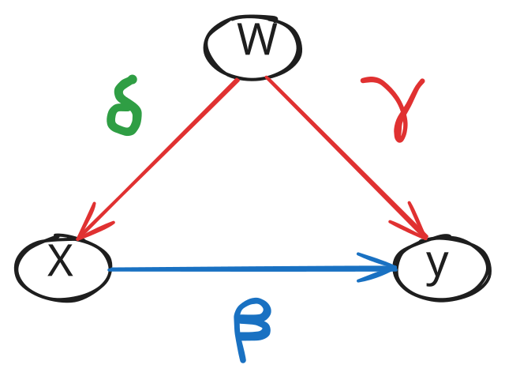
:::

:::

# What to do? {background-color="#002147"}

## Wrong answer
### Include whatever and as much as you have!

{.center}

## Deal with imbalance ($\delta$) *by design*

:::{.r-stack}

:::{.fragment}
**RCT**: An ideal approach would be to randomly assign who gets the treatment of interest and who doesn't. This breaks the $W \rightarrow X$ link

**Quasi-Exp**: Sometimes, it is possible to find an event or sub-population in which the treatment is *as-good-as-random*. In theory, this should also deals with $\delta$

{.fragment .center}
:::

{.fragment .center}

:::

## Benchmarking and sensitivity

Instead of assuming away OVB, we can try to bound the estimated treatment effect under plausible assumptions around its magnitude

:::{.r-stack}

:::{.fragment}
**Worst-case bounds:** Assume a $W$ perfectly predicting $Y$ (strongest possible $\gamma$), and ask how much the imbalance ($\delta$) should be to change our conclusions
  
**Simulate:** Use a range of $\gamma \times \delta$ values to simulate how the results would change for a range of values of OVB

**Benchmark:** Use included variables to benchmark the magnitude of the possibly excluded factors
:::

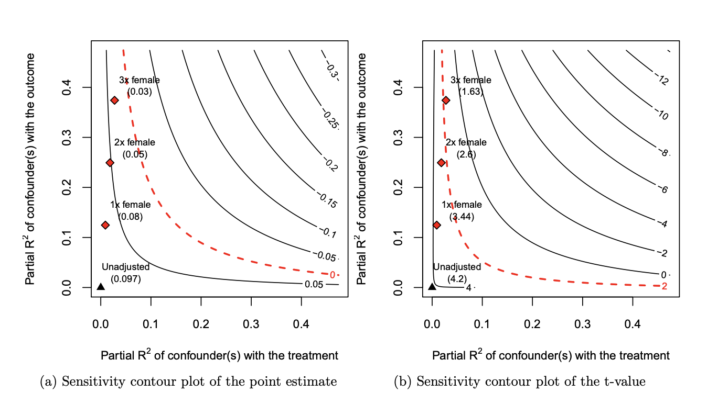{.fragment .center}

:::

## Summary and beyond: When is OVB an issue?

* Ask yourself if you're trying to get a causal relationship

  - Define your treatment with enough detail so you can ask, [*what factors affecting both the outcome and who gets the treatment*]{.fragment .highlight-blue} may be missing
  
  - Bias is always [*relative to a target quantity*]{.fragment .highlight-blue}

* Remember: there is always omission, but it's not always a problem!
  
  - **Outcome**: efficiency loss, but not necessarily bias
  
  - **Treatment-related**: it may even be better (bias amplification)
  
  - [Both? Danger zone!]{.fragment .highlight-red}

* Bias *relative* to a target quantity!

## {.center}

{width="1500"}

# Graphical models (DAGs) {background-color="#002147"}

## From assumptions to models

We have emphasized that it is not the method what makes our results credible, but how credible our [**assumptions**]{style="color:red"} are

. . .

However, what makes our assumptions credible?

. . .

To answer that question, we need to be explicit about our **model**, i.e., how do we believe the world works

. . . 

+ In this session we will introduce a framework that makes formulating such models easy and intuitive

+ We will develop the machinery needed to be explicit about our model and derive its testable implications

. . . 

Researchers often leave the model implicit and unspecified. I will argue that making it explicit can greatly improve transparency in scientific communication

# Graphical models {background-color="#17a091"}

## Structural Causal Model (SCM)

Unifying approach to causal inference, developed by Pearl, Robins, among others, following early developments by Wright:

* (Non-parametric) Structural Equation Models
  
* Generalization of the path analysis and SEM you might be familiar with

* Graphical representation using Directed Acyclic Graphs (DAGs)

* Potential Outcomes are [**derived** from]{style="color:blue"} a SCM

* Transparent representation of **qualitative assumptions**

* Testable implications of our model of the data generating process

---

## Directed Acyclic Graphs (DAGs)

Probabilistic graphical models are mathematical objects that represent relations among variables (probability factorization) 

They are compounded by two ingredients: [**nodes**]{style="color:green"} (vertices) and [**edges**]{style="color:green"} (links)

Directed Acyclic Graphs (DAGs) are one class of graphical models, with the following characteristics:

. . .

* [**Directed**]{.fragment .highlight-blue}: The edges point *from* one variable *to* another variable

* [**Acyclic**]{.fragment .highlight-blue}: The paths in the graph flow in certain direction, if you follow the edges you cannot arrive back to the starting point

* [**Graph**]{.fragment .highlight-blue}: well, you get it!

. . .

:::{.callout-warning}
## Important! Under certain conditions, a DAG can be causally interpreted, in which case we talk about "causal DAGs" or causal diagrams

Basically, this happen when we assume that no pair of nodes share a common ancestor that is not included in the DAG
:::

---

## Paths

We can go from one variable to another following a [*path*]{style="color:blue"} along the edges 

When you can traverse a path without colliding into an edge in the opposite direction we call it a [**connecting path**]{style="color:green"} that transmit information

When you encounter an edge pointing into the opposite direction along a path we call it a [**blocking path**]{style="color:red"} that do not transmit information

:::{.callout-warning}
## Faithfulness
$d-$connection in the graph implies association between variables in the data, while $d-$separation implies their independence
:::

Keep in mind: sometimes it is **not** about the variables (alone), but about the paths that, together, they create!

## Building blocks

* A [**chain**]{style="color:green"}, in which you can travel from $X$ to $Y$ through $M$, is a $d-$connected path. All variables are [*marginally associated*]{style="color:green"}

$$X \color{green}{\rightarrow} M \color{green}{\rightarrow} Y$$

* A [**fork**]{style="color:green"}, in which you can go from a common cause $W$ to both $X$ and $Y$ is a $d-$connected path. All variables are [*marginally associated*]{style="color:green"}

$$X \color{green}{\leftarrow} W \color{green}{\rightarrow} Y$$

* A [**collider**]{style="color:red"}, in which you can't go from $X$ to $Y$ due to two edges pointing into a third variable $C$, is a $d-$separated path. $X$ and $Y$ are [*marginally independent*]{style="color:red"}
 

$$X \color{red}{\rightarrow} C \color{red}{\leftarrow} Y$$

## Flipping the switch

* When you adjust for the intermediate variable $M$ in a chain, $X$ and $Y$ become $d-$separated and, therefore, [*conditonally independent*]{style="color:red"}: 

$$X \rightarrow \boxed{M} \color{red}{\rightarrow} Y$$

* When you adjust for the common cause $W$ in a fork, $X$ and $Y$ become $d-$separated and, therefore, [*conditionally independent*]{style="color:red"}: 

$$X \color{red}{\leftarrow} \boxed{W} \color{red}{\rightarrow} Y$$

* When you adjust for a collider variable $C$, the pair $X$ and $Y$ become $d-$connected and, therefore, [*conditionally associated*]{style="color:green"}: 

$$X \color{green}{\cdots} \boxed{C} \color{green}{\cdots} Y$$

## Alternative representations

 

A graphical model is [one possible]{style="color:green;"} representation of a causal system. 

In the [Structural Causal Model]{style="color:blue;"}, we will sometimes appeal to other alternative, but equivalent, representations. Depending on what do you want to achieve, different representations may be more or less useful

In particular, we will look at:

* A set of [structural equations]{.fragment .highlight-blue} indicating functional dependencies between variables

* A [truncated factorization]{.fragment .highlight-blue} of the joint probability distribution of the variables in the graph:

$$P(X_1, X_2, \dots, X_n) = \prod_i P(X_i|pa_i)$$

:::aside
This is call a "Markov condition": the future is independent of the remote past conditional on the immediate past!
:::

## Alternative representations: chaining paths

 

:::{.columns}

:::{.column width=50%}

[**Graphical model**]{style="color:blue;"}

$$X \rightarrow M \rightarrow Y$$

 

| [**Structural Equations**]{style="color:blue;"} |
|-----|
| $X = f_x(U_x)$ |
| $M = f_m(X, U_m)$ |
| $Y = f_y(M, U_y)$ |

:::aside
Note: Independent errors can be dropped from the DAG!
:::

:::

:::{.column width=50%}

[**Truncated factorization**]{style="color:blue;"}

$$P(X,M,Y) = P(X) P(M|X) P (Y|M)$$

 

**Natural factorization**

(chain rule)

$P(X,M,Y) = P(X|M,Y)P(M|Y)P(Y)$

$P(X,M,Y) = P(M|X,Y)P(X|Y)P(Y)$

$P(X,M,Y) = P(M|X,Y)P(Y|X)P(X)$

$P(X,M,Y) = P(Y|X,M)P(X|M)P(M)$

:::

:::

## Alternative representations: forking paths

 

:::{.columns}

:::{.column width=50%}

[**Graphical model**]{style="color:blue;"}

$$X \leftarrow W \rightarrow Y$$

 

| [**Structural Equations**]{style="color:blue;"} |
|-----|
| $X = f_x(W, U_x)$ |
| $W = f_w(U_w)$ |
| $Y = f_y(W, U_y)$ |

:::aside
Note: Independent errors can be dropped from the DAG!
:::

:::

:::{.column width=50%}

[**Truncated factorization**]{style="color:blue;"}

$$P(X,W,Y) = P(W) P(X|W) P (Y|W)$$

 

**Natural factorization**

(chain rule)

$P(X,W,Y) = P(X|W,Y)P(W|Y)P(Y)$

$P(X,W,Y) = P(W|X,Y)P(X|Y)P(Y)$

$P(X,W,Y) = P(W|X,Y)P(Y|X)P(X)$

$P(X,W,Y) = P(Y|X,W)P(X|W)P(W)$

:::

:::

## Alternative representations: colliding paths

 

:::{.columns}

:::{.column width=50%}

[**Graphical model**]{style="color:blue;"}

$$X \rightarrow C \leftarrow Y$$

 

| [**Structural Equations**]{style="color:blue;"} |
|-----|
| $X = f_x(U_x)$ |
| $C = f_c(X, Y, U_c)$ |
| $Y = f_y(U_y)$ |

:::aside
Note: Independent errors can be dropped from the DAG!
:::

:::

:::{.column width=50%}

[**Truncated factorization**]{style="color:blue;"}

$$P(X,C,Y) = P(X) P(Y) P (C|X,Y)$$

 

**Natural factorization**

(chain rule)

$P(X,C,Y) = P(X|C,Y)P(C|Y)P(Y)$

$P(X,C,Y) = P(C|X,Y)P(X|Y)P(Y)$

$P(X,C,Y) = P(C|X,Y)P(Y|X)P(X)$

$P(X,C,Y) = P(Y|X,C)P(X|C)P(C)$

:::

:::

# Practice {background-color="#17a091"}

## Forking paths

:::{.columns}

:::{.column width=50%}

| Structural Equations |
|-----|
| $W = f_w(U_w)$ |
| $X = f_x(W, U_x)$ |
| $Y = f_y(W, X, U_y)$ |

 

Are $X$ and $Y$ marginally independent?

Are they conditionally independent?
:::

:::{.column width=50%}

The DAG includes the following paths

$$X \rightarrow Y$$

$$X \leftarrow W \rightarrow Y$$
:::

:::

## Forking paths

:::{.columns}

:::{.column width=50%}

| Structural Equations |
|-----|
| $W = f_w(U_w)$ |
| $X = f_x(W, U_x)$ |
| $Y = f_y(W, X, U_y)$ |

 

Are $X$ and $Y$ marginally independent?

Are they conditionally independent?
:::

:::{.column width=50%}

The following path is open

$$X \rightarrow Y$$

But this is now closed

$$X \leftarrow \boxed{W} \rightarrow Y$$
:::

:::

## Forking paths

:::{.columns}

:::{.column width=50%}

| Structural Equations |
|-----|
| $W = f_w(U_w)$ |
| $X = f_x(W, U_x)$ |
| $Y = f_y(W, U_y)$ |

 

Are $X$ and $Y$ marginally independent?

Are they conditionally independent?

Is there a causal effect of $X$ on $Y$?
:::

:::{.column width=50%}

The DAG includes the following path

$$X \leftarrow W \rightarrow Y$$
:::

:::
---

## Chaining paths

:::{.columns}

:::{.column width=50%}

| Structural Equations |
|-----|
| $X = f_x(U_x)$ |
| $M = f_m(X, U_m)$ |
| $Y = f_y(M, X, U_y)$ |

 

Are $X$ and $Y$ marginally independent?

Are they conditionally independent?

Is there a causal effect of $X$ on $Y$?
:::

:::{.column width=50%}

The DAG includes the following paths

$$X \rightarrow Y$$

$$X \rightarrow M \rightarrow Y$$
:::
:::
---

## Chaining paths

:::{.columns}

:::{.column width=50%}

| Structural Equations |
|-----|
| $X = f_x(U_x)$ |
| $M = f_m(X, U_m)$ |
| $Y = f_y(M, X, U_y)$ |

 

Are $X$ and $Y$ marginally independent?

Are they conditionally independent?

Is there a causal effect of $X$ on $Y$?
:::

:::{.column width=50%}

The DAG includes the following path

$$X \rightarrow Y$$

But this path is now closed

$$X \rightarrow \boxed{M} \rightarrow Y$$
:::

:::

## Colliding paths

:::{.columns}

:::{.column width=50%}

| Structural Equations |
|-----|
| $X = f_x(U_x)$ |
| $Y = f_y(W, X, U_y)$ |
| $C = f_c(X, Y, U_c)$ |

 

Are $X$ and $Y$ marginally independent?

Are they conditionally independent?

Is there a causal effect of $X$ on $Y$?
:::

:::{.column width=50%}

The DAG includes the following paths

$$X \rightarrow Y$$

$$X \rightarrow C \leftarrow Y$$
:::

:::
---

## Colliding paths

:::{.columns}

:::{.column width=50%}

| Structural Equations |
|-----|
| $X = f_x(U_x)$ |
| $Y = f_y(W, U_y)$ |
| $C = f_c(X, Y, U_c)$ |

 

Are $X$ and $Y$ marginally independent?

Are they conditionally independent?

Is there a causal effect of $X$ on $Y$?
:::

:::{.column width=50%}

The DAG includes the following path

$$X \rightarrow C \leftarrow Y$$
:::

:::
---

## Colliding paths

:::{.columns}

:::{.column width=50%}

| Structural Equations |
|-----|
| $X = f_x(U_x)$ |
| $Y = f_y(W, X, U_y)$ |
| $C = f_c(X, Y, U_c)$ |

 

Are $X$ and $Y$ marginally independent?

Are they conditionally independent?

Is there a causal effect of $X$ on $Y$?
:::

:::{.column width=50%}

The DAG includes the following (open) path

$$X \rightarrow \boxed{C} \leftarrow Y$$
:::

:::

## Side note: are colliders that important? {background-color="#dce0ca"}

  

One common question (and an area of debate among practitioners) is if colliders are really that important *in applied settings*. This is a hard question to answer, because, you know... we just don't know. 

But we know that they are **possible** and that their importance would depend on the structure of our causal graph.

A few compelling examples of collider bias in recent social sciences are discussed by:

* [Shalizi and Thomas (2011)](https://journals.sagepub.com/doi/abs/10.1177/0049124111404820) in the context of network homophily and contagion

* [Breen (2018)](https://academic.oup.com/esr/article/34/6/603/5094485) in the context of intergenerational mobility

* [Knox, Lowe and Mummolo (2020)](https://scholar.princeton.edu/jmummolo/publications/bias-built-how-administrative-records-mask-racially-biased-policing) in the context of police shootings

A great general introduction to the topic is offered by [Elwert and Winship (2014)](https://www.annualreviews.org/doi/abs/10.1146/annurev-soc-071913-043455)

---

## Do-operator and interventions

Pearl introduced the $do-$operator to clearly distinguish between passive observations and interventions on the data generating process

In other words, is a form to make explicit the gap between interventional quantities and out more familiar conditional expectations

Causal identification corresponds to removing the $do-$operator from an expression, following the rules of $do-$calculus, reducing it to an observational quantity. If there is no equivalence, it means that the quantity of interest is not identified

Given the correspondence between a system of non-parametric structural equations and a given DAG, we can express the operation of **doing** as a *minimal surgery on the structural equation defining the treatment*

---

## Interventional graphs

:::{.columns}

:::{.column width=50%}

| Structural Causal Model |
|---|
| $Z_1 = f_{z1}(U_{z1})$ |
| $Z_2 = f_{z2}(U_{z2})$ |
| $W = f_{w}(Z_1, Z_2, U_{w})$ |
| $X = f_{z1}(Z_1, W, U_{x})$ |
| $Y = f_{y}(Z_2, W, U_{y})$ |

Let's start with the observational data generating process above

:::

:::{.column width=50%}
{width=65%}
:::

:::

---

## Interventional graphs

:::{.columns}

:::{.column width=50%}

| Structural Causal Model |
|---|
| $Z_1 = f_{z1}(U_{z1})$ |
| $Z_2 = f_{z2}(U_{z2})$ |
| $W = f_{w}(Z_1, Z_2, U_{w})$ |
| $X = x$ |
| $Y = f_{y}(Z_2, W, U_{y})$ |

Intervening in the model to make $X=x$ creates an interventional graph $G_{\bar{X}}$, in which all the incoming arrows into $X$ have been removed

:::

:::{.column width=50%}
{width=65%}
:::

:::

---

## Interventional graphs

:::{.columns}

:::{.column width=50%}

| Structural Causal Model |
|---|
| $Z_1 = f_{z1}(U_{z1})$ |
| $Z_2 = f_{z2}(U_{z2})$ |
| $W = f_{w}(Z_1, Z_2, U_{w})$ |
| $X = f_{z1}(Z_1, W, U_{x})$ |
| $Y = f_{y}(Z_2, W, U_{y})$ |

The purpose of an observational study is to allow only **causal paths** between the treatment $X$ and the outcome $Y$, and block all the **non causal paths**

:::

:::{.column width=50%}
{width=65%}

Adjusting for $W$ blocks a non-causal path, but opens a new one. 

$P(Y|do(x))$ is not identified conditioning on $W$ alone

:::

:::

---

## Interventional graphs

:::{.columns}

:::{.column width=50%}

| Structural Causal Model |
|---|
| $Z_1 = f_{z1}(U_{z1})$ |
| $Z_2 = f_{z2}(U_{z2})$ |
| $W = f_{w}(Z_1, Z_2, U_{w})$ |
| $X = f_{z1}(Z_1, W, U_{x})$  |
| $Y = f_{y}(Z_2, W, U_{y})$ |

The purpose of an observational study is to allow only **causal paths** between the treatment $X$ and the outcome $Y$, and block all the **non causal paths**
:::

:::{.column width=50%}
{width=65%}

Adjusting for $(Z_1,W)$ blocks all non-causal paths

$P(Y|do(x))$ is identified conditioning on $(Z_1,W)$
:::

:::

---

## Interventional graphs

:::{.columns}

:::{.column width=50%}

| Structural Causal Model |
|---|
| $Z_1 = f_{z1}(U_{z1})$ |
| $Z_2 = f_{z2}(U_{z2})$ |
| $W = f_{w}(Z_1, Z_2, U_{w})$ |
| $X = f_{z1}(Z_1, W, U_{x})$  |
| $Y = f_{y}(Z_2, W, U_{y})$ |

The purpose of an observational study is to allow only **causal paths** between the treatment $X$ and the outcome $Y$, and block all the **non causal paths**
:::

:::{.column width=50%}

{width=65%}

Adjusting for $(Z_2,W)$ also blocks all non-causal paths

$P(Y|do(x))$ is identified conditioning on $(Z_2,W)$
:::

:::

---

## Back-door Criterion (Pearl) {background-color="#002f87"}

 

What we just did can be summarized by the back-door criterion

A set of variables $W$ satisfied the back-door criterion relative to an ordered pair of variables $(X,Y)$ in a DAG $G$ if:

  (i) no node in $W$ is a descendant of $X$; and
  (ii) $W$ blocks every path between $X$ and $Y$ that contains an arrow into $X$

$\color{red}{\text{Important:}}$ satifying the backdoor criterion implies the unconfoundedness assumption
$$Y_x \indep X|W$$

The **back-door adjustment** (aka **g-formula**) indicates that we can recover the effect of $X$ on $Y$ adjusting for any $W$ that satisfy the backdoor criterion

$$P(Y|do(x)) = \sum_w P(Y|X,W)P(W)$$

:::aside
Pearl, *Causality*, pp.79-81
:::
---

## Short activity (5 mins) {background-color="#692044"}

Can you check, using the rules we practiced, if it is possible to identify the causal effect of $D$ on $Y$ in the following graphs?

Model 1: 

$D \rightarrow M$

$M \rightarrow Y$

$D \leftarrow (U) \rightarrow Y$

Where $(U)$ is unobserved, and therefore, it cannot be adjusted for

Model 2:

$D \rightarrow Y$

$Z \rightarrow D$

$D \leftarrow (U) \rightarrow Y$

Where $(U)$ is unobserved, and therefore, it cannot be adjusted for

## SCM: Key insights

* Causal identification is contingent on a given model encoding our assumptions

* Causal identification is finding an observational quantity that is equivalent to an interventional quantity

* Confounding (and bias) is a property of paths in a graph, not variables

* Confounding is relative to the pair $(X,Y)$, not just $X$

* It is not necessary to adjust for all *parents* of the treatment to block all backdoor paths

* Bias is not monotonically decreasing on the number of variables included

* $do-$calculus can be used to identify the effect of multiple interventions, to recover from missingness data, and to generalize study results.

## SCM: limitations

. . . 

Conditional on your model, most identification tasks are rather trivial (algorithmic). But before that you need to assume a certain DAG!

. . .

:::{.callout-warning}
## "Causality is in the model"
James Heckman (2005)
:::

. . . 

However, this is something that we always do! The only matter is how transparent are we about the assumptions we are making anyway

. . .

Another problem, more important for issues like mediation analysis and counterfactuals in general, is that we are sometimes making more assumptions that we are willing to

. . . 

For these cases, other causal (and graphical) models, like the [Single World Intervention Graphs](https://www.csss.washington.edu/Papers/wp128.pdf) (Richardson and Robins, 2013) can help

. . . 

Being fully non-parametric, certain canonical models are not identified using DAGs (like IVs). 

. . . 

However, this only shows that they require parametric assumptions, no matter how weak!

